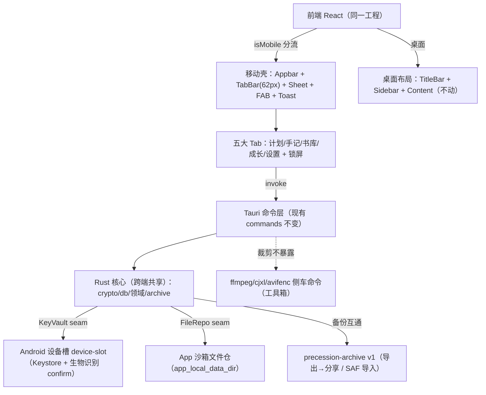

# Precession Android 移动端开发设计

> 版本：draft-1　适用阶段：桌面端收尾，移动端（Android）正式启动
> 范围：仅 Android；iOS 搁置；不做云端同步，数据互通只保留「备份文件导入导出」

---

## 1. 决策与范围

| 决策点 | 结论 | 说明 |
|---|---|---|
| 工程形态 | 单工程整合（现有 Tauri 2 工程加 Android target） | 不拆仓库；加密核心与领域层跨端 100% 复用 |
| 首发平台 | 仅 Android | iOS 配置与代码保留但不投入；`tauri.ios.conf.json` 不动 |
| 数据互通 | 仅备份文件导入导出 | 复用现有 `precession-archive` 格式；真同步后置，只留 seam |
| 移动端范围 | 计划 / 手记 / 书库 / 成长 / 设置（五大 Tab） | 以 `design/mobile/index.html` 交互稿为准 |
| 明确不做 | 工具箱（文件加密 / 图片转码 / 视频处理）、桌面「今天」页 | 设计稿「移动端取舍」已声明：无加密、转码、视频处理 |

**质量目标**：桌面端零回归；移动端只做现有能力的移动化呈现，不新增领域逻辑；所有 CRUD 走现有 invoke 命令，Rust 侧只做平台适配层的最小改动。

## 2. 现状盘点

### 2.1 已具备（核查 `D:\precession`）

| 项目 | 位置 | 状态 |
|---|---|---|
| Android target 工程 | `src-tauri/gen/android`、`tauri.android.conf.json`（externalBin 已置空） | ✅ 已初始化 |
| Android 设备槽插件 | `src-tauri/device-slot`（Keystore：`enroll/open/confirm/forget`，权限组已生成） | ✅ 已实现 |
| 平台抽象 | `src-tauri/src/platform/`（`Platform` trait + `android.rs` 挂 device-slot） | ✅ 已实现 |
| SQLCipher | `rusqlite` + `bundled-sqlcipher-vendored-openssl`（跨端编译已跑通） | ✅ 不再展开 |
| 备份通道 | `src-tauri/src/archive/`（`archive_export/import/info`） | ✅ 已实现，跨端格式一致 |
| 解锁命令面 | `db_status/create/unlock/lock/enable_device_unlock/unlock_device/disable_device_unlock` | ✅ 已实现 |
| 前端平台探测 | `src/store/app.ts`：`isMobile()`（plugin-os `platform()`）；根路由移动端默认落在计划 | ✅ 已实现 |
| 前端移动导航 | `src/router/items.ts` `mobileNavItems()`、`src/layout/content/aside/mobile.tsx` | ✅ 已实现 |
| 锁屏/设备解锁 UI | `src/layout/lock/`、`src/features/lock/device-unlock.tsx`、`lock-archive.tsx` | ✅ 已实现 |
| 页面级移动适配 | `plan`(drawer)、`journal`、`growth`、`date-field`、`image`、`video` 已有 `html[data-platform="mobile"]` 分支 | 🟡 部分覆盖 |
| 移动端 UI 交互稿 | `design/mobile/index.html` + `mobile.css/js` + preview | ✅ 设计就绪 |

### 2.2 缺口（本次开发要解决的）

| # | 缺口 | 影响 | 处理 |
|---|---|---|---|
| G1 | 五大 Tab 页面与交互稿的差距 | 计划页缺「周历卡片 + 底部详情面板」形态；编辑器缺移动全屏形态 | 移动组件补齐（见 §5） |
| G2 | 移动端文件选择/保存通道 | 导入导出、添加书需要 SAF 文件选择；导出需要可分享文件 | dialog 插件验证 + 导出分享方案（见 §6.4） |
| G3 | `mobile.json` 权限不足 | 缺 `dialog` 权限 | 补权限（见 §6.3） |
| G4 | 附件能力对 ffmpeg 的依赖未厘清 | 手记/成长贴图、文件预览可能踩侧车 | 依赖清单核查 + 移动端裁剪（见 §6.2） |
| G5 | 移动端构建/调试环境 | 本地 Windows 首次 Android 构建链路未跑通 | 参考 `docs/wsl-android.md` 落地（见 §7） |
| G6 | 桌面回归风险 | 共享 store/命令改动影响桌面 | 双端冒烟清单（见 §8） |

## 3. 总体架构（移动端视图）



- 前端：单 React 工程，`useAppStore.isMobile()` 分流；移动端用独立壳组件 + 复用现有页面逻辑/Store/命令。
- Rust：**不新增领域命令**。唯一可能的新增是「导出分享/导入流」通道（§6.4），以及附件缩略图方案（§6.2）。
- 裁剪面：工具箱（cipher/image/video/files 管理页）不出现在移动导航；侧车命令不被调用，代码保留。

## 4. 移动端界面范围（对照交互稿）

画布 390×844，左右边距 16px，触控高度 ≥44px，底部导航 62px，安全区 28+22px。

### 4.1 页面清单与复用映射

| 交互稿 screen | 交互稿要点 | 现有前端对应 | 处理 |
|---|---|---|---|
| `plan` | 周历卡片（周切换/今天）+ 当日议程 + 清单筛选 chips + FAB | `features/plan/page.tsx`（已有 drawer 移动分支） | 补「周历卡片」形态；详情走底部 Sheet |
| `plan` 详情 Sheet | 标题/完成/日期/时间/清单/优先级/步骤/备注/删除 | `features/plan/` drawer | 移动端改底部面板 |
| `journal` | 日记/灵感/写作 segmented + 月份分组列表 | `features/journal/page.tsx`（有 mobile CSS） | 对齐 segmented 与卡片 |
| `journal-entry` | 详情页（类型/高光/时间/字/图/标签） | `features/journal/entry-page.tsx` | 复用 |
| `journal-editor` | 全屏编辑器：类型/标题/正文/元数据 chips/工具栏/封存 | 桌面编辑器所在位置需确认 | 新建移动全屏编辑器（复用 Markdown 编辑器组件） |
| `growth` | 家人横排 + 个人卡片 + 生长测量卡 + 里程碑/瞬间 segmented + 年份时间线 | `features/growth/page.tsx`（有 mobile CSS） | 对齐形态 |
| `growth-entry` / `growth-editor` | 记录详情 / 记一笔（成员/日期地点/照片/高光） | `features/growth/entry-page.tsx` | 编辑器移动化 |
| `book`（书籍详情） | 封面/状态/进度/继续阅读/写笔记/书摘/删除 | `features/library/`（page/read-page/reader-page） | 补「书籍详情」移动组件 |
| `reader` | 进度条/章/目录/书摘/阅读设置 dock | `features/library/reader-page.tsx` | 移动适配（readerdock） |
| `files`（移动） | 占用统计/分类 chips/预览/打开记录/导出/删除 | `features/files/`（桌面管理页） | 移动端只做只读预览 + 归属跳转，**不实现管理** |
| `settings` | 外观/阅读/数据与安全（设备解锁/文件/导入导出/锁定）/关于 | `features/settings/`（appearance/reading/security/versions 已存在） | 对齐分组；确认导入导出入口位置 |
| `lock` | 密码 + 指纹解锁 | `layout/lock/` + `features/lock/` | ✅ 已有，对齐交互稿 |

### 4.2 底部面板（Sheet）清单

计划详情 / 主题 / 阅读偏好 / 版本 / 添加书（文件导入+手动）/ 文件预览 / 目录 / 写书摘 / 启用设备解锁 / 导入与导出 / 记一次（生长）/ 家人 / 锁定档案。

> 现有桌面弹层组件（`components/modal`、`plan/drawer`）可复用样式骨架；移动端统一为底部滑出面板，宽 100%、圆角顶栏。

## 5. 前端改造方案

1. **壳层**：`src/layout/content/index.tsx` 已按 `isMobile()` 切换移动主区；补移动壳组件（Appbar + TabBar + Sheet 层 + Toast），与交互稿 `mobile.css` 对齐（tabbar 62px、FAB、安全区 `env(safe-area-inset-*)`）。
2. **路由**：现有路由复用（`/plan /journal /growth /library /settings`），移动端隐藏工具箱路由入口；`html[data-platform="mobile"]` 已由现有代码设置。
3. **页面策略**：优先「现有页面 + 移动 CSS 分支」；交互稿形态差异大的页面（计划周历、编辑器、书籍详情、设置导入导出）新建移动组件，但**只重排呈现，不重复数据逻辑**（继续走现有 Store/Hooks/命令）。
4. **新增文件建议**：`src/mobile/` 放壳与移动专属组件；`src/features/*/mobile/*.tsx` 放单页面移动视图；`design/mobile/mobile.css` 的变量（主色/四模块 tone）并入 `src/style/` 变量体系。
5. **锁屏流程**：复用现有 `LockView`；指纹按钮调 `db_unlock_device`（内部走 device-slot `confirm`），密码调 `db_unlock`；设置页「启用设备解锁」调 `db_enable_device_unlock(password)`，「锁定档案」调 `db_lock`。

## 6. Rust / 能力侧改动

### 6.1 平台边界（Android 现状）

| Seam | 桌面实现 | Android 实现 | 本次动作 |
|---|---|---|---|
| KeyVault | Windows Hello / macOS Keychain | `device-slot`（`AndroidDevice` 经 `attach_device` 挂接） | 无新增 |
| Biometric | Hello 雏形 | device-slot `confirm` | 无新增 |
| FileRepo | 用户目录 | `app_local_data_dir()`（Android 为应用私有目录） | 确认 `upload`/`archive` 路径语义不变 |
| 备份互通 | archive 命令 | 同命令；仅文件选择/分享通道不同 | 见 §6.4 |

### 6.2 附件能力裁剪（核查项 G4）

- 已确认可跨端：书库解析（`book/` 模块纯 Rust，epub/mobi/txt）、`upload_open` 加密区间流（预览/播放）、archive 打包解包（`zip` crate，Stored 不压缩）。
- **待核查**：`upload/media_info`、`upload_image`、缩略图生成是否依赖 `ffmpeg` 侧车（`src-tauri/src/upload/`、`image/`）。若依赖：
  - 移动端手记/成长贴图 v1 走「原图直入仓」（`upload_stage/create/attach`），缩略图改用 `image` crate（纯 Rust 解码 png/jpeg/webp，已在依赖）或前端按需流式加载；
  - `media_info` 相关展示降级为不显示媒体元信息。
- 工具箱命令（`ffmpeg_probe`、`collect_files` 等）移动端不暴露、不调用；`tauri.android.conf.json` 已置 `externalBin: []`，侧车不会打包进 APK。

### 6.3 capabilities（核查项 G3）

`src-tauri/capabilities/mobile.json` 现为 `core:default + log:default + os:default`，需补：

```jsonc
// mobile.json 追加
"dialog:default"   // SAF 文件选择（导入/添加书）
```

`default.json`（桌面）不动。`shell` 权限**不**加入移动端。

### 6.4 导入导出与文件通道（核查项 G2，风险最高）

- 导入：`archive_import(path)`、`book_create` 走 `dialog.open()`（Android SAF，返回可读路径，待实测插件行为：Tauri dialog 在 Android 会把选中文件落到应用缓存并提供可读路径）。
- 导出：`archive_export(path)` 需要可写路径。**待验证**：`dialog.save()` 在 Android 的支持情况。
  - 若 `save()` 可用：导出后写 SAF 路径（需插件把 content:// 映射到 Rust 可写路径，实测确认）；
  - 若不可用（预期）：**新增轻量 Android 插件**（沿用 `device-slot` 模式）提供「写缓存 + ACTION_SEND 系统分享」，或引入社区分享插件。
  - 决策点：Q1 确认导出入口的交互形态（分享面板 vs 保存到指定位置）。
- 兜底：v1 最低可用方案 = 导出压缩包写入应用缓存目录 + 系统分享面板；桌面导入该压缩包即可完成互通。

## 7. 构建与运行（Windows 本地）

```bash
pnpm install
# 开发（需 adb 连接的设备或模拟器；首次需配置 ANDROID_HOME/NDK/JDK）
pnpm app:android            # tauri android dev --host 127.0.0.1
# 产物
pnpm build:android          # tauri android build --target aarch64 → gen/android/app/build/outputs/
```

- 环境与踩坑记录见 `docs/wsl-android.md`（Windows 侧构建 Android 的既有说明）。
- Rust target：`aarch64-linux-android`；SQLCipher/OpenSSL 交叉编译已跑通（用户确认），首次构建耗时较长，CI/本机缓存 `~/.cargo` 与 `src-tauri/target`。
- 签名：debug 自动签名；发布需在 `gen/android` 工程配置正式 keystore（上架备案后再处理）。

## 8. 测试与验收

### 8.1 双端冒烟（每次共享代码改动后）

- 桌面（Windows）：启动 → 解锁 → 计划/手记/成长/书库/设置主要路径 → 导出备份。
- Android：启动 → 锁屏 → 解锁（密码/指纹）→ 五 Tab 核心路径 → 导入桌面备份 → 数据一致 → 再导出。

### 8.2 移动端专项验收

| 项 | 验收标准 |
|---|---|
| 解锁链路 | `db_status` → 密码解锁 / device-slot `confirm` 指纹解锁；锁定后回锁屏 |
| 五大 Tab | 与 `design/mobile` 交互稿形态一致：Tab 切换、FAB、Sheet 面板、Toast |
| 搜索 | 计划/手记/成长/书库搜索均可命中（复用现有查询） |
| 附件预览 | 加密流 `upload_open` 打开图片/文档；不显示 ffmpeg 元信息不报错 |
| 书库 | 从文件导入 EPUB/MOBI/TXT 可读（纯 Rust 解析）；阅读器滚动/目录/书摘/偏好 |
| 备份互通 | 桌面导出 → Android 导入（密码重开）→ 数据一致；反向同验；导入后设备解锁自动关闭 |
| 触控 | 控件 ≥44px；安全区（刘海/手势条）不遮挡 TabBar |
| WebView | Android 系统 WebView：文本输入、Milkdown 编辑器、滚动性能回归 |

### 8.3 不做（记录在案）

- 移动端不提供：文件管理（增删/转码）、工具箱、`今天`页、多窗口/托盘、云同步、iOS。

## 9. 里程碑

| 阶段 | 内容 | 验收 |
|---|---|---|
| P0 能力核查（0.5 周） | 核查 G2/G4：dialog Android 行为实测、upload 命令 ffmpeg 依赖清单、导出通道方案定稿 | 输出决策记录，无阻塞项 |
| P1 移动壳 + 计划/设置（1.5 周） | 移动壳组件；计划周历 + 详情 Sheet；设置分组对齐；导入导出入口 UI | 两 Tab 可在真机跑通、风格与交互稿一致 |
| P2 手记/成长（1.5 周） | 全屏编辑器；成长时间线/测量/家人/记一笔 | 新建/编辑/搜索闭环 |
| P3 书库（1 周） | 书架/书籍详情/阅读器适配/添加书/书摘 | 导入书籍可读、阅读偏好生效 |
| P4 互通 + 解锁 + 回归（1 周） | 导出分享通道落地；备份双向互通验收；双端冒烟；APK 打包 | 验收清单全绿（§8） |
| P5（可选） | 上架备案/签名/商店 | 另行决策 |

## 10. 风险与待验证项

| # | 风险/待验证 | 影响 | 缓解 |
|---|---|---|---|
| R1 | `dialog.open/save` 在 Android 的实际行为（content:// vs 缓存路径） | 导入导出通道方案 | P0 真机实测，双方案备选（§6.4） |
| R2 | upload 命令对 ffmpeg 的隐藏依赖 | 贴图/预览功能裁剪粒度 | P0 依赖清单核查；image crate 兜底 |
| R3 | 桌面回归 | 共享代码改动波及桌面 | 双端冒烟（§8.1） |
| R4 | 首次 Android 构建时长/环境 | 开发节奏 | 按 `docs/wsl-android.md` 落地；缓存 target |
| R5 | 移动端上架备案（自用可绕过） | 发布 | 后置，另行决策 |

## 11. 关联资料

- 移动端交互稿：`design/mobile/index.html`（本设计唯一 UI 依据）
- Android 环境说明：`docs/wsl-android.md`
- 桌面发布参考：`docs/windows-publish.md`、`docs/mac-android.md`
