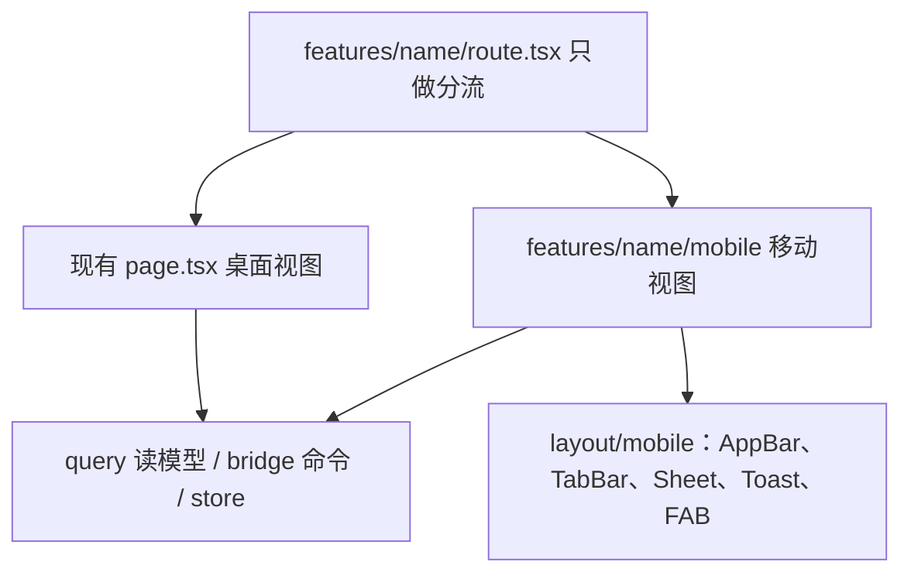

# Precession Android 移动端开发设计

适用阶段：桌面端收尾之后，开始做 Android。本文只定边界、目录和接入方式。UI 以 [design/index.html](../design/index.html) 为准（画布 390×844）。同目录的 `mobile.css` / `mobile.js` 是交互稿的样式和示意逻辑，不整份引进工程。

## 1. 决策与非目标

| 决策 | 结论 |
|---|---|
| 工程 | 继续用现有 Tauri 2 仓库，加 Android target。不拆前端，不拆 Rust crate |
| 平台 | 只做 Android。`isMobile()` 仍包含 `ios`，`tauri.ios.conf.json` 保留，iOS 不排期 |
| 数据互通 | 只有备份压缩包。命令是 `archive_export` / `archive_import`，参数是本地路径 |
| 产品面 | 计划、手记、成长、书库、设置，加上详情、全屏编辑、阅读器、附件只读页、锁屏 |
| 前端结构 | 共享数据层不动。信息架构不同的页面新建移动视图。桌面 `page.tsx` 留在原处 |
| Rust | 不新增领域命令。领域读写继续走 `src/bridge` 和 `src/query` |

不做这些事，本文不展开方案：

- 云同步。互通只靠压缩包进出。
- 工具箱：文件加密、图片转码、视频处理。底栏不出现，侧车不打进 APK。
- 桌面「今天」页。移动端打开后落在计划。
- iOS 工程、上架签名、应用商店。

质量要求：桌面主路径保持可跑。移动端是现有能力的另一套界面，不在手机上发明新的档案字段或命令。

## 2. 现状

### 2.1 已经有的

| 能力 | 位置 |
|---|---|
| 平台判断 | [src/store/app.ts](../src/store/app.ts) 的 `isMobile()`：`android` 或 `ios`。启动时由 `@tauri-apps/plugin-os` 写入，之后不变 |
| 默认落点 | [src/router/index.tsx](../src/router/index.tsx)：移动端 `/` 重定向到 `/plan`，桌面到 `/today` |
| 底栏五项 | [src/router/items.ts](../src/router/items.ts) `mobileNavItems()`：计划、手记、成长、书库、设置。今天和工具箱只在桌面侧栏 |
| 移动壳 | [src/layout/content/index.tsx](../src/layout/content/index.tsx) 在移动端渲染竖向主区加 [src/layout/content/aside/mobile.tsx](../src/layout/content/aside/mobile.tsx)。标题栏在移动端只留安全区高度（[src/layout/titleBar/index.tsx](../src/layout/titleBar/index.tsx)） |
| 锁屏与设备解锁 | [src/layout/lock](../src/layout/lock) 调用 `dbUnlock` / `dbUnlockDevice`。设置里的启用与关闭在 [src/features/lock](../src/features/lock)，对应 `dbEnableDeviceUnlock` / `dbDisableDeviceUnlock` / `dbLock` |
| Android 设备槽 | [src-tauri/device-slot](../src-tauri/device-slot)：`enroll` / `open` / `confirm` / `forget`。由 [src-tauri/src/platform/mod.rs](../src-tauri/src/platform/mod.rs) 的 `attach_device` 挂上 |
| 备份 | [src/bridge/archive.ts](../src/bridge/archive.ts) 与 [src-tauri/src/archive/commands.rs](../src-tauri/src/archive/commands.rs)。导入成功后会关掉设备解锁（`archive/service.rs` 里的 `disable_device`） |
| 工具箱裁剪 | [src/features/cipher/page.tsx](../src/features/cipher/page.tsx)、`image/page.tsx`、`video/page.tsx` 在移动端返回空 `section`。手机端侧车入口 [src-tauri/src/task/platform.rs](../src-tauri/src/task/platform.rs) 的 `ensure_desktop()` 返回 `DesktopOnly`。`tauri.android.conf.json` 的 `externalBin` 已是空数组 |
| 手记列表形态 | [src/features/journal/page.tsx](../src/features/journal/page.tsx) 已有日记 / 灵感 / 写作分段，并按月份分组 |

数据流在两端相同：读走 `src/query` 的 `useQuery`，写在页面或子组件里直接调 `src/bridge`。`QueryClientProvider` 包在解锁后的 `ContentView` 上。锁屏不经过 react-query。

### 2.2 和交互稿之间的缺口

- 路由现在直接挂桌面页。没有 `route.tsx`，也没有 `features/*/mobile/`。
- 一批 CSS Modules 写了 `:global(html[data-platform="mobile"])`（计划日历和抽屉、手记、成长、书库、文件、模态、记录卡）。`src/style/index.css` 还在等 `html[data-touch-ui="true"]`。这两处属性都没有写入点，选择器目前不会生效。
- 移动端没有交互稿里的顶栏、底部面板、Toast、FAB。底栏高度用的是 `--dock-h: 4rem`（64px），交互稿是 62px。
- 计划桌面是多视图日历加侧边抽屉。读到 `?create` / `?id` 后会 `replace` 清掉 search，再开本地状态的抽屉。这套打不开系统返回键。
- 手记新建同样：`page.tsx` 读到 `search.create` 后设本地 `creating`，再 `replace` 清 search，打开 [src/features/journal/components/editor.tsx](../src/features/journal/components/editor.tsx)。
- 设置是一页四段（外观、阅读、数据与安全、版本），见 [src/features/settings/page.tsx](../src/features/settings/page.tsx)。交互稿把主题、阅读、版本、导入导出、设备解锁、锁定档案收成底部面板。
- 书库详情和沉浸阅读还是桌面的 [src/features/library/reader-page.tsx](../src/features/library/reader-page.tsx)、[src/features/library/read-page.tsx](../src/features/library/read-page.tsx)。
- [src-tauri/capabilities/mobile.json](../src-tauri/capabilities/mobile.json) 只有 `core:default`、`log:default`、`os:default`。导入需要的 `dialog:default` 还没加。
- 桌面导出依赖 `plugin-dialog` 的 `save()`（[src/bridge/archive.ts](../src/bridge/archive.ts) 的 `pickArchiveSave`）。Android v1 不用这条。

## 3. 前端分层



三层的边界：

| 层 | 放什么 | 这次怎么动 |
|---|---|---|
| 共享 | `src/bridge`、`src/query`、`src/store`、按钮 / 字段 / [src/components/markdown/editor.tsx](../src/components/markdown/editor.tsx) | 不改职责。移动视图直接 `useQuery`，写操作直接调已有 bridge 函数 |
| 桌面视图 | 现有 `features/*/page.tsx` 和它们的组件 | 留在原路径。不为了移动端先把 mutation 抽空 |
| 移动视图 | `features/<name>/mobile/`，外加 `src/layout/mobile/` | 信息架构不同的页面新建。只重排呈现 |

### 3.1 路由怎么接入

需要两套界面的 feature 增加 `route.tsx`，里面只做 `isMobile()` 分支。`src/router/index.tsx` 改为挂 `route.tsx`。`page.tsx` 继续导出桌面实现，避免大范围改名。

```tsx
export function PlanRoute() {
  const mobile = useAppStore((state) => state.isMobile());
  return mobile ? <MobilePlanPage /> : <PlanPage />;
}
```

第一批 `route.tsx`：

| 路由 | 桌面 | 移动 |
|---|---|---|
| `/plan` | `features/plan/page.tsx` | `features/plan/mobile/page.tsx` |
| `/growth` | `features/growth/page.tsx` | `features/growth/mobile/page.tsx` |
| `/library/$bookId` | `features/library/reader-page.tsx` | `features/library/mobile/book.tsx` |
| `/library/$bookId/read` | `features/library/read-page.tsx` | `features/library/mobile/read.tsx` |
| `/settings` | `features/settings/page.tsx` | `features/settings/mobile/page.tsx` |
| `/files` | `features/files/page.tsx` | `features/files/mobile/page.tsx` |

`/journal`、`/journal/$entryId`、`/growth/$entryId`、`/library` 先继续挂现有页面，见第 4 节。`/today`、`/cipher`、`/image`、`/video` 不增加移动视图。工具箱三页保持现在的空壳，底栏不链过去。

### 3.2 actions 抽取

写第二遍相同的「创建 / 更新 / 删除 / 再刷新 query」时，把这段抽到 `features/<name>/actions.ts`，同一次改动里让桌面调用点改用它。函数可以是普通 async 函数，也可以是 hook；优先普通函数，让两边的 `useMutation` 只负责 pending 和错误文案。

不预先把桌面抽屉、编辑器里的 mutation 全部搬走。只有移动视图真的要抄同一段时才抽。

### 3.3 返回键

Android 返回键走 hash history。可关闭的界面用 TanStack Router 的 search 表示，不用纯 `useState` 盖一层遮罩。

- 计划移动页保留现有 `create`、`id`。打开详情或新建时写入 search，返回时去掉。桌面页那种「读完就 `replace` 成空 search」留在桌面 `page.tsx`，移动页不复制。
- 手记、成长的全屏编辑沿用现有 `create`（成长还有 `kind`、`member`）。移动端在 search 还在时渲染全屏编辑器。保存或取消时导航回没有该 search 的列表。
- 主题、阅读、版本、添加书、导入导出、设备解锁、锁定确认、目录、书摘、文件预览、记一次生长、家人，用当前路由上的 `sheet` search。打开写成 `sheet=theme` 这种值，返回键去掉 `sheet`。校验函数加在对应路由的 `validateSearch` 里。
- 壳层提供 `Sheet` 组件，由页面根据 search 渲染。不做全局面板注册表。

沿用中的手记列表是唯一一处允许留在桌面文件里的平台分支：`page.tsx` 在移动端不要清掉 `create`，并改渲染 `features/journal/mobile/editor.tsx`。列表 JSX 保持一份。桌面继续用 `components/editor.tsx`。成长首页整页换掉，所以这条分支只发生在手记列表。

## 4. 页面对照

交互稿的 `data-screen` 和工程的对应关系：

| 交互稿 | 移动端怎么做 | 桌面 |
|---|---|---|
| `plan` | 新建 `features/plan/mobile/page.tsx`：周历卡片、当日议程、清单 chips、FAB「新建计划」 | 多视图日历留在 `page.tsx` |
| `plan` 详情 | 同目录 `detail-sheet.tsx`，底部 Sheet。字段仍是标题、完成、日期时间、清单、优先级、步骤、备注、删除 | 侧边 `plan-drawer.tsx` |
| `journal` | 沿用 `features/journal/page.tsx`。分段和月份分组已经有。靠 `data-platform` 和已有单列样式对齐卡片 | 同一文件 |
| `journal-entry` | 沿用 `features/journal/entry-page.tsx` | 同一文件 |
| `journal-editor` | 新建 `features/journal/mobile/editor.tsx`。正文用 `MarkdownEditor`。类型、标题、元数据 chips、封存按交互稿排成全屏页 | `components/editor.tsx` 布局不动 |
| `growth` | 新建 `features/growth/mobile/page.tsx`：家人横排、个人卡片、生长测量、里程碑/瞬间、年份时间线 | `page.tsx` |
| `growth-entry` | 沿用 `features/growth/entry-page.tsx` | 同一文件 |
| `growth-editor` | 新建 `features/growth/mobile/editor.tsx`。选家人、里程碑或瞬间、照片、高光 | `components/editor.tsx` |
| `library` | 书架沿用 `features/library/page.tsx`。已有移动搜索和三列网格样式。差一块「继续阅读」时加在这一页，不另建书架 | 同一文件 |
| `book` | 新建 `features/library/mobile/book.tsx`：封面、状态、进度、继续阅读、书摘 | `reader-page.tsx` |
| `reader` | 新建 `features/library/mobile/read.tsx`：点按显隐工具条、进度、目录、书摘。章节仍走 `bookQuery` / `bookChapter` | `read-page.tsx` |
| `files` | 新建 `features/files/mobile/page.tsx`。从设置进入，不是 Tab。占用、分类、预览、跳到所属记录 | 管理页留在 `page.tsx` |
| `settings` | 新建 `features/settings/mobile/page.tsx`。分组列表，面板见下表 | 长页四段留在 `page.tsx` |
| `lock` | 沿用 `src/layout/lock`，按交互稿排密码和指纹 | 同一套锁屏 |

手记列表、手记详情、成长详情如果排出来仍对不上交互稿（缺月份分组、详情仍是抽屉而不是一页），再升成 `mobile/` 视图。不预先拆。

设置和相关面板（`sheet` 取值）：

| sheet | 内容 | 已有逻辑 |
|---|---|---|
| `theme` | 浅色 / 深色 / 跟随系统 | `appearance` 与 `store` 的主题 |
| `reading` | 字号、字体、行距、版心、纸色。移动默认字号按交互稿 19px | `settings/reading.tsx` |
| `versions` | 应用、系统、WebView、数据库、构建。侧车版本不展示 | `settings/versions.tsx` |
| `archive` | 导出、导入 | `settings/security.tsx` 里的 archive 调用 |
| `device` | 输入档案密码后启用设备解锁 | `dbEnableDeviceUnlock` |
| `lockconfirm` | 确认后 `dbLock`，回到锁屏 | `features/lock/lock-archive.tsx` |
| `addbook` | 从文件导入 EPUB / MOBI / TXT，或手动建档 | 桌面 `library/components/add-book.tsx` 的 `bookPeek` / `bookCreate` |
| `fileviewer` | 预览、打开所属记录。移动端到此为止 | 上传的加密流打开 |
| `toc` / `excerpt` | 阅读器目录、写书摘 | 现有大纲和 `bookNote*` |
| `measure` / `family` | 记一次身高体重、家人列表 | 现有 growth / member 命令 |

FAB 只出现在计划和手记：计划是新建，手记是写一条。成长的「记一笔」和书库的添加放在顶栏，按交互稿，不做成 FAB。

## 5. 壳层与样式

新建 `src/layout/mobile/`，由 `ContentLayout` 的移动分支挂上底栏和安全区。页面自己渲染顶栏。

| 文件 | 职责 |
|---|---|
| `app-bar.tsx` | 标题和右侧操作。各移动页放在内容顶部。高度用已有 `--header-h` |
| `tab-bar.tsx` | 从 `aside/mobile.tsx` 迁入，数据仍用 `mobileNavItems()`。迁完后删掉旧底栏文件 |
| `sheet.tsx` | 贴底、顶圆角、可滚动。计划详情等面板共用。确认框继续用现有 `Modal` |
| `toast.tsx` | 短提示。跨页面时用一个很小的 store，不另建通知系统 |
| `fab.tsx` | 右下主按钮。由计划页和手记页放置 |

`TitleBar` 在移动端继续只占 `--inset-top`，不再承担标题。

启动时，`isMobile()` 为真就给 `documentElement` 写上：

- `data-platform="mobile"`，让已经写好的移动 CSS 生效
- `data-touch-ui="true"`，让 `src/style/index.css` 里的触摸规则生效

写在应用启动、平台已经确定的地方（`App` 或 store 初始化之后），只写一次。

样式令牌继续用 [src/style/token.css](../src/style/token.css)。模块色 `--plan`、`--journal`、`--growth`、`--library` 已经在。在 `html[data-platform="mobile"]` 上把 `--dock-h` 改成 `62px`，与交互稿底栏一致。触控高度沿用 `--tap: 2.75rem`（44px）。页面左右边距 16px 写在移动页自己的 CSS Module 里。安全区继续用 `--inset-top` / `--inset-bottom`。

深色仍是 `html.dark`，由现有外观偏好切换。阅读器纸色只作用在阅读页，和全站主题分开，这条桌面已经这样，移动阅读器照做。

`design/mobile.css` 的字体栈、示意用的状态栏和手势条不进入应用。字体继续用工程里已经加载的文楷。

## 6. Rust 与文件通道

领域命令保持现状。手机上会走到的写路径就是桌面已经有的那些：计划、手记、成长、书库、成员、上传、档案、数据库解锁。

| 缝 | Android 上 |
|---|---|
| 设备密钥 | device-slot 的 Keystore。前端只调 `dbEnableDeviceUnlock` / `dbUnlockDevice` / `dbDisableDeviceUnlock`，不直接调插件 |
| 指纹 | device-slot 的 `confirm`。解锁按钮调 `dbUnlockDevice` |
| 档案文件 | 应用私有目录。`archive_export` / `archive_import` 的路径语义不变 |
| 工具箱 | `ensure_desktop()` 拒绝。`externalBin` 保持空。移动 capabilities 不加 `shell` |

[src-tauri/capabilities/mobile.json](../src-tauri/capabilities/mobile.json) 增加 `dialog:default`。桌面的 `default.json` 不动。

### 6.1 导入

设置里的导入仍调用 `archiveImport(path)`。选文件用 `plugin-dialog` 的 `open()`（Android 上是 SAF）。P0 在真机确认返回值是 Rust 能读的路径，再让 `pickArchiveOpen` 在 Android 上走通。导入成功后会话关闭、设备解锁关闭，这是现有 archive 行为，移动 UI 把交互稿那句说明展示出来，然后回到锁屏。

添加书的「从文件导入」同样用 `open()`，再走现有 `bookPeek` / `bookCreate`。文件复制进档案，不移动用户选中的原件。

### 6.2 导出

v1 导出是：`archive_export_share` 把压缩包写到应用缓存，再由设备槽插件的 `share` 打开系统分享（`ACTION_SEND`，沿用工程里已有的 FileProvider `cache-path`）。不新开插件工程，因为设备槽已经拿着当前 Activity。不调用 `save()`，也不做「保存到用户指定目录」。文件名沿用 `precession-YYYY-MM-DD.zip`。桌面仍走 `archive_export` 和保存对话框。

桌面用「另存为」导出的同一个 zip，手机导入；手机分享出去的 zip，桌面导入。格式不另做一版。

### 6.3 附件

`src-tauri/src/upload` 不调用 ffmpeg 或侧车。手记和成长的图片继续走现有上传命令。`MarkdownEditor` 在移动端已经把「先转 AVIF」关掉。某条缩略图或媒体信息在手机上失败时，该处不展示，不把 ffmpeg 引进 APK。

附件页只做预览和跳回所属手记、成长或书。删除、转码、加密留在桌面文件页。

## 7. 里程碑

| 阶段 | 内容 | 完成标准 |
|---|---|---|
| P0 通道 | 真机确认 `dialog.open` 的路径能被 `archive_import` 读到。定下分享是现成插件还是自写 `ACTION_SEND`。给 `mobile.json` 加上 `dialog:default` | 一条导入路径在真机上读到了压缩包；分享方案写死，没有二选一 |
| P1 壳、计划、设置 | 写入 `data-platform` 和 `data-touch-ui`。落地 `layout/mobile`。计划周历和详情 Sheet。设置分组和 `theme` / `reading` / `versions` / `archive` / `device` / `lockconfirm` | 真机上两个 Tab 的导航、返回键、面板和交互稿一致。桌面计划页和设置页仍按原样打开 |
| P2 手记、成长 | 手记全屏编辑器。成长首页、记一笔、记一次生长、家人 | 新建、编辑、搜索能闭环。返回键先关编辑器再离开列表 |
| P3 书库 | 书籍详情、阅读器、添加书、目录和书摘。书架只补交互稿里还缺的块 | EPUB / MOBI / TXT 能打开。阅读偏好作用在移动阅读器上 |
| P4 互通 | 导出分享落地。附件只读页。锁屏视觉对齐。桌面导出 → Android 导入 → 再导出。桌面冒烟 | 第 8 节全部通过，并能打出 aarch64 APK |

本地命令已经在 `package.json`：`pnpm app:android`、`pnpm build:android`。环境步骤见 [docs/wsl-android.md](wsl-android.md)。

## 8. 验收

每次改到共享的 bridge、query、store 或 Rust 命令，桌面和 Android 都走一遍：

- 桌面：启动、解锁、计划 / 手记 / 成长 / 书库 / 设置的主路径、导出备份。
- Android：启动、锁屏、密码解锁和指纹解锁、五个 Tab、导入桌面备份、数据一致、再导出。

移动端专项：

| 项 | 标准 |
|---|---|
| 解锁 | 密码走 `dbUnlock`。已启用设备解锁时指纹走 `dbUnlockDevice`。锁定后回到锁屏 |
| 五个 Tab | 底栏顺序、FAB 只在计划和手记、Sheet 能用返回键关闭、安全区不挡住底栏 |
| 搜索 | 计划、手记、成长、书库沿用现有查询 |
| 编辑器 | 手记和成长的全屏编辑使用 `MarkdownEditor`，保存后回到列表 |
| 书库 | 从文件导入的 EPUB / MOBI / TXT 能读。目录、书摘、阅读偏好可用 |
| 附件 | 加密流能打开图片。不出现转码、加密、视频处理入口 |
| 备份 | 双向导入导出后内容一致。导入后设备解锁关闭，要用档案密码再打开 |
| 桌面 | 计划多视图、设置长页、工具箱、文件管理页行为保持原样 |

关联：交互稿 [design/index.html](../design/index.html)，Android 环境 [docs/wsl-android.md](wsl-android.md)。
