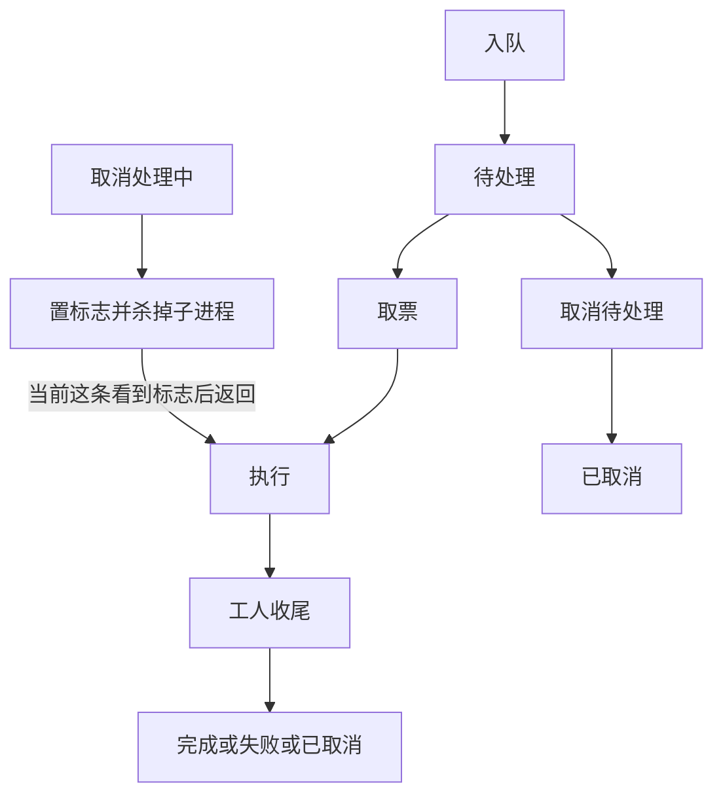

# 任务队列

耗时的文件任务放在内存队列里，由一条名为 `task-worker` 的后台线程按顺序执行。载荷里有文件密码，不能入库。进程退出后队列消失。

同一时刻只跑一条。全局只有一个侧车进程槽，处理中的取消要杀掉的就是这一条子进程。

## 对外协议

前端 [src/bridge/task.ts](../src/bridge/task.ts) 不用改。命令名、事件名和 JSON 形状保持不变。

| 命令 | 作用 |
| --- | --- |
| `task_enqueue` | 校验参数，投影展示快照，放入队列 |
| `task_list` | 返回当前队列 |
| `task_cancel` | 按状态取消 |
| `task_remove` | 拿走一条不在处理中的任务 |
| `task_reveal` | 在系统文件管理器中打开路径。实现不在任务模块里，命令名保留 |

事件：

- `task-update`：一条 `Task`
- `queue-updated`：当时的全部任务

`Task`、`TaskInput`、`TaskDraft` 仍用 camelCase。`kind` 在线上仍是 `encryptFile`、`decryptFile`、`importUpload`、`encryptUpload`、`decryptUpload`、`convertVideo`、`cutVideo`、`mergeVideo`、`appendVideo`、`convertAvif`、`convertJxl`。进度是 0 到 100，含两端。界面按这个范围画进度条。

密码不出现在 `Task`、`TaskDraft` 和两种事件里。

## 队列记录

队列只保存状态机和展示快照。它不匹配任务变体，也不依赖加解密规格或侧车规格。

状态机字段：

- `id`
- 状态：`pending`、`processing`、`completed`、`failed`、`canceled`
- `progress`：0 到 100
- `message`
- 取消标志

展示快照在入队时投影一次，之后只读：类型、标题、输出路径、上传文件 ID、草稿。类型是枚举，序列化成上面的 camelCase 字符串。不另存一套 `KIND_*` 字符串常量。草稿由同一次投影产生。

执行载荷放在 `Option<Work>` 里。`Work` 只有两个变体，加解密和侧车各一个。队列只负责放入、取走和丢弃，不打开它。工人取票时把载荷搬走，队列里不再留规格。因此展示快照必须在入队时写好，不能等执行期再从规格推。

同一目标已有待处理或处理中的任务时，入队返回「这个文件正在处理」。已完成、失败、已取消不占目标。目标按种类取：

| 种类 | 目标 |
| --- | --- |
| 加密文件、解密文件 | 输出路径 |
| 导入上传文件 | 源路径 |
| 加密上传文件、解密上传文件 | 上传文件 ID |
| 视频和图片转码 | 输出路径 |

正在处理的任务不能删除，返回「正在处理，不能删除」。其余状态可以删除。

## 展示快照

投影函数只在入队时调用一次。标题用文件名，路径取不到文件名时用「未命名」。多文件用第一个文件名，多于一个时接上「等 N 个」。

| 种类 | 标题 | 输出 | 草稿 |
| --- | --- | --- | --- |
| 加密或解密文件 | 输入文件名 | 输出路径 | 输入和输出，无密码 |
| 导入上传文件 | 源文件名 | 空 | 无 |
| 加密或解密上传文件 | 「上传文件」 | 空 | 无。快照带上传文件 ID |
| 转换、裁剪视频 | 输入文件名 | 输出路径 | 路径、片段和编码参数 |
| 合并视频 | 各段的代表名 | 输出路径 | 各段路径和编码参数 |
| 追加视频 | 基准片加各段的代表名 | 输出路径 | 基准、各段、输出和编码参数 |
| 转成 AVIF、JPEG XL | 输入文件名 | 输出路径 | 路径和图片参数 |

## 两条执行线

工人取到票之后匹配一次 `Work`。加解密模块只接收加解密载荷，侧车模块只接收侧车载荷。两边都不匹配对方的变体。

### 加解密

种类是加密文件、解密文件、导入上传文件、加密上传文件、解密上传文件。步骤只有复制、加密、解密。进度按步骤权重分摊，每步权重都是 1。字节增量达到 1 MiB，或该文件已经读完时，才通过回调报告。百分比按已完成权重加上当前文件比例，四舍五入后夹在 0 到 100。

任一步失败或取消时删掉临时文件。提交失败时再删掉最终目标。

| 种类 | 步骤 | 提交 |
| --- | --- | --- |
| 加密或解密文件 | 直接写到输出路径 | 无 |
| 导入且不加密 | 复制到 `upload/.tmp/{id}.part` | 在提交锁下改名到 `upload/{kind}/{id}.{ext}`，插入文件记录 |
| 导入且加密 | 先复制到 `upload/.tmp/{id}.plain`，再加密到 `upload/.tmp/{id}.part` | 同上，并标为已加密 |
| 加密或解密已上传文件 | 写到原文件的旁路文件 | 用旁路文件换上原文件，再改加密标志 |

换上原文件之前先确认数据库可写。换文件失败时删掉旁路文件。改加密标志失败时用备份盖回原文件。导入得到的上传文件 ID 写回快照。

导入的类型可以是 `image`、`video`、`book`、`file`，也是 `upload/` 下的子目录名。扩展名取源文件的小写扩展名，记录里同时存原始文件名和字节数。插入记录失败时删掉改名后的文件。

`upload/` 和 `db/` 平级，都在 `app_local_data_dir/data/` 下。孤儿清理（`upload/storage.rs` 的 `sweep_now`）在同一把提交锁下删掉表里没有记录的文件，但跳过 `.tmp` 和保留文件的 `.part`、`.bak`、`.aside` 旁路文件。建库或解锁后、删除计划、手记、成长、书和书摘之后，都会在后台跑一次。`upload/.tmp` 只在启动、任务工人开始之前清空。

已加密的上传文件再加密，返回「文件已经加密」。未加密的上传文件再解密，返回「文件还没有加密」。这两项在入队时就拒绝。

### 侧车

种类是转换视频、裁剪视频、合并视频、追加视频、转成 AVIF、转成 JPEG XL。非桌面在入队时返回「仅桌面端支持」，不进队列。

工人在当前线程上阻塞执行，按种类调用 ffmpeg 或图片转换。成功时不产生上传文件 ID。进度由执行方通过 `JobCtx` 报告，范围同样是 0 到 100。

裁剪的时间片段不能为空。视频编码参数在入队时收紧。路径去掉两端空白，源必须是已存在的文件，输出不能和任一输入相同。

## 进度和取消

工人是队列和两种事件的唯一写入者。`JobCtx` 只持有取消标志，以及工人给的报告回调。它不拿应用句柄，也不访问队列。回调在任务仍是处理中时写下进度和消息，并发出 `task-update`。状态已经离开处理中时，回调不写、不发。

「准备开始...」只在取票时写一次，进度记为 0，并发出 `task-update`。

| 时机 | `task-update` | `queue-updated` |
| --- | --- | --- |
| 入队成功 | 不发 | 整表 |
| 取票 | 这一条 | 不发 |
| 执行中报告 | 这一条 | 不发 |
| 收尾 | 这一条 | 整表 |
| 取消待处理 | 这一条，状态已是已取消 | 整表 |
| 取消处理中 | 不发 | 不发。等收尾 |
| 删除成功 | 不发 | 整表 |

取消按状态分支：

- 待处理：立刻改为已取消，消息写成「已取消」，丢掉载荷。不杀子进程。
- 处理中：只把取消标志置真，并杀掉当前侧车子进程。状态仍是处理中，这次不发事件。执行方看到标志后返回已取消，工人收尾时改状态、写「已取消」，再发 `task-update` 和 `queue-updated`。
- 已完成、失败、已取消：不改状态，不杀进程。

收尾时清掉载荷。成功则状态为完成、进度 100、消息「完成」；若结果带上传文件 ID，写入快照。失败则状态为失败，消息用错误的显示文本。已取消则状态为已取消，消息「已取消」。

## 密码

口令只放在需要它的加解密载荷里：加密文件、解密文件、加密后导入、加密上传文件、解密上传文件。不加密的导入在校验后丢掉口令，载荷里不保留。侧车载荷没有口令字段。

校验失败、入队失败、待处理取消、取票后的 `Drop`，都会清零口令。取票之后，口令只留在工人手里的那份载荷上。

## 模块

代码在 `src-tauri/src/task/`。

| 文件 | 职责 |
| --- | --- |
| `commands.rs` | `task_enqueue`、`task_list`、`task_cancel`、`task_remove` |
| `dto.rs` | `Task`、`TaskInput`、`TaskDraft`、类型枚举 |
| `queue.rs` | 状态机、展示快照、忙闲和取消。不依赖规格类型 |
| `worker.rs` | 取票、匹配一次 `Work`、收尾、发出两种事件 |
| `ctx.rs` | `JobCtx`：取消标志和报告回调 |
| `crypto.rs` | 加解密的校验、步骤、提交 |
| `sidecar.rs` | 视频和图片的校验、分发 |
| `step.rs` | 复制、加密、解密，以及旁路替换和备份恢复 |
| `constants.rs` | 事件名和状态字符串 |
| `error.rs` | 返回给前端的错误文本 |

不设同时承载两条执行线的 `service` 模块。

`task_reveal` 按操作系统打开文件或其所在目录，放在 `platform`。命令名仍是 `task_reveal`，在 [src-tauri/src/commands.rs](../src-tauri/src/commands.rs) 注册。非桌面返回「仅桌面端支持」。

## 状态流

待处理取消不经过工人。处理中取消只打断执行，状态要等工人收尾才变成已取消。
